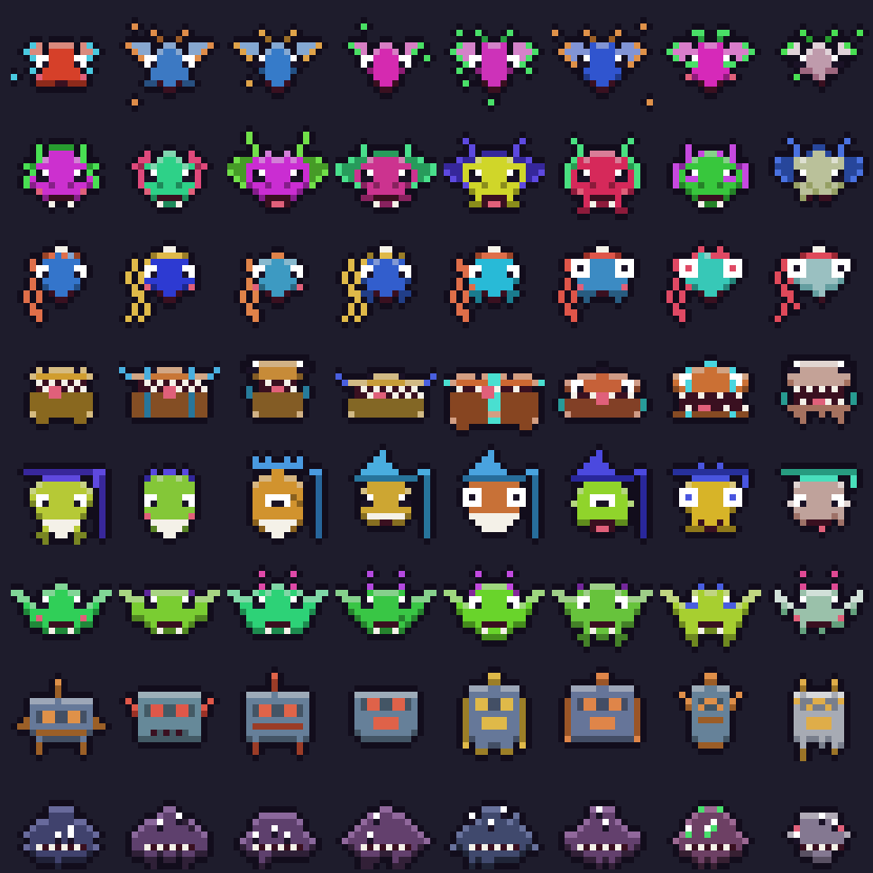

# ファイル・クエスト

長く使われていないファイルと戦う、ターン制の RPG です。世界地図を歩き、戦い、町で売り買いして、依頼をこなします。

倒したファイルは「回収待ち」にたまります。町の回収所で、**本体の確認を 1 回だけ通してから**、ごみ箱へ送ります。戦闘中・店・依頼では、ごみ箱に触れません。

[explorer_plus](https://github.com/Neptunity-git/explorer_plus) の MOD です。`neo.file-quest` 1.4.0。フォルダと関係ないビューなので、どのフォルダを開いていても使えます。




上の絵は、ゲームの中のドット絵の見本です。

## 遊びかた

- 冒険の地にするフォルダを選びます。ドライブやパスを入れて選ぶこともできます。そのフォルダの古いファイルが、モンスターになります。同じフォルダなら、同じ島になります。
- 世界地図を、矢印キーか W A S D で歩きます。敵に出会うと、戦闘になります。
- 戦闘は、たたかう・とくぎ・ぼうぎょ・どうぐ・にげる、から選びます。敵がこうげきするときは、小さな枠の中でハートを動かして、弾をよけます。Esc でとばせます。
- 町には、宿屋・道具屋・鍛冶屋・依頼所・回収所・酒場があります。建物のドアに立つと、画面が開きます。
- 酒場では、仲間にできる人に会えます。仲間は、パーティに最大 4 人です。

### ファイルを守るしくみ

- 敵になるのは、長く使われていないファイルだけです。標準は 730 日です。設定で変えられます。
- システムの場所と `dll` などの部品、最近開いたものは、敵になりません。同期やコピーの直後のアクセス日時も、「使った」とは数えません。
- 大事そうなファイルは、鑑定で守られて、敵になりません。「守られたファイル」で確かめられます。
- 戦う直前に、そのファイルがまだあるか、もう一度確かめます。
- 冒険の地は、古いファイルが 30 個以上・合計 200MB 以上・600 個まで、の場所だけ選べます。設定で変えられます。

## 通信（任意）

通信先は `api.anthropic.com` だけです。**API キーを入れて、設定の「AIでセリフ・鑑定・依頼・物語を作る」をオンにしたときだけ**、動きます。キーが無くても、全部の機能が遊べます。

- 送るのは、ファイル名・拡張子・サイズ・未使用の期間だけです。**ファイルの中身は読まず、送りません。**
- 設定の「鑑定でフォルダ名も送る」をオンにしたときだけ、フォルダ名も送ります。標準はオフです。
- AI は、二つ名・セリフ・敵の技・鑑定・依頼・冒険日誌を作ります。結果の数値は、ルールが決めます。AI の返事は、決まった形・範囲に合うか検査して、合わないものは捨てます。
- API キーは、設定の「Anthropic の API キー」に入れます。キーは本体が預かり、MOD のコードには渡りません。

## 入れ方

1. [Releases](https://github.com/Neo-Neptunity/file-quest/releases) を開き、いちばん新しい版の zip（`neo.file-quest-版.zip`）をダウンロードします。「Source code」ではなく、自分で付けた zip のほうです。
2. explorer_plus のホームの「MOD」の欄で「＋ MOD を入れる（zip）」を押して、zip を選びます。解凍はしません。
3. 確認の画面の「このビューが使う情報」と、通信先を読んで、よければ入れます。

## 使う情報

| 使う情報 | 使いみち |
|---|---|
| `size` `modified` | 大きさと更新日時で、敵の強さと、討伐対象かどうかを決める |
| `search` | 選んだフォルダの下から、古いファイルを集める |
| `fileInfo` | アクセス日時を読んで、「使ったかどうか」を見分ける。設定の「アクセス日時も見る」がオンのときだけ |
| `links` | 保存したファイル ID から、今の場所を引く。戦う直前と、回収のときの確かめに使う |
| `recent` | 最近開いたファイルを、敵にしない |
| `quickAccess` | 冒険の地の候補に、クイックアクセスのフォルダを出す |
| `collections` | 倒したファイルを、コレクション「ファイル・クエスト 討伐済み」にも入れる。エクスプローラからも見える |

## 設定

討伐対象にする未使用の日数・アクセス日時も見る・冒険の地の古いファイルの数と合計 MB の上下限・敵の出やすさ・仲間の操作（おまかせ / 自分で選ぶ）・弾よけの有無・効果音・デバッグ機能・AI の使用とモデル（Haiku 5.5 / Sonnet 5.5）・鑑定でフォルダ名も送る・API キー。

## 作りかた

- [docs/design.md](docs/design.md)：設計書
- [dev/](dev/)：自動の試験と、画面を撮る道具。説明は [dev/README.md](dev/README.md)。そこに書かれたコマンドは、作者の置き場所から流す書き方です。このリポジトリでは、先頭の `file-quest/` を外して読んでください。

```
node dev/unit.mjs
```

Node.js だけで動きます。

## ライセンス

[MIT](LICENSE)
